# IP Long-Term Sustainability Strategy

**Refining × Distribution × Multi-Energy Mobility**

Interactive Group Strategy & Decision-Support Prototype

[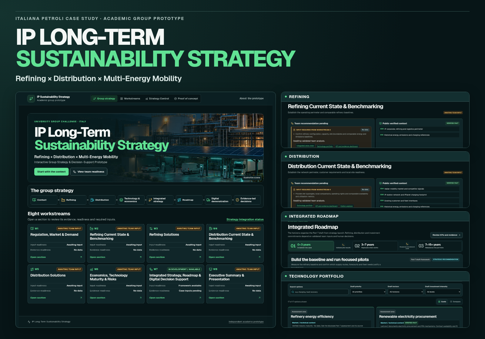](https://queenkm.github.io/ip-transition-strategy/)

## Live demo

**[Explore the group strategy](https://queenkm.github.io/ip-transition-strategy/)** · [Team input readiness](https://queenkm.github.io/ip-transition-strategy/#/workstreams) · [GitHub Pages workflow](.github/workflows/deploy.yml)

## The challenge

Develop a long-term sustainability strategy for Italiana Petroli in Italy. The university brief asks the group to connect refining and distribution and explain technology choices, timing, demand and investment constraints.

## Complete strategy

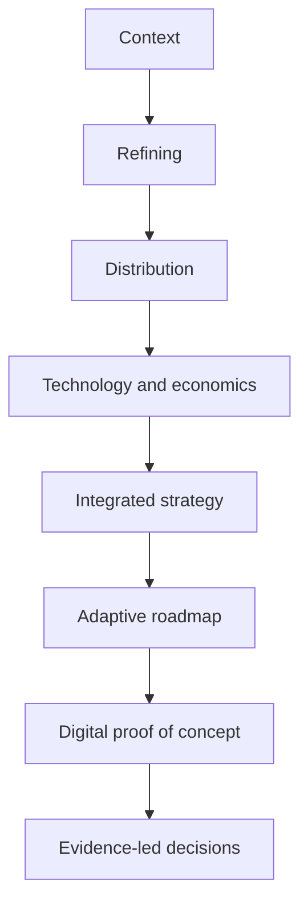

The platform gives all eight workstreams a place in the group solution. Workstream 7 links upstream analyses to strategic pillars, an adaptive roadmap, governance, measurement and a digital proof of concept. Workstream 8 holds the group-approved recommendation and presentation storyline once validated.

## Workstreams 1–8

| Workstream | Scope | Input status |
| --- | --- | --- |
| [W1](https://queenkm.github.io/ip-transition-strategy/#/workstreams/w1) | Regulation, Market & Demand | Awaiting team input |
| [W2](https://queenkm.github.io/ip-transition-strategy/#/workstreams/w2) | Refining Current State & Benchmarking | Awaiting team input |
| [W3](https://queenkm.github.io/ip-transition-strategy/#/workstreams/w3) | Refining Solutions | Awaiting team input |
| [W4](https://queenkm.github.io/ip-transition-strategy/#/workstreams/w4) | Distribution Current State & Benchmarking | Awaiting team input |
| [W5](https://queenkm.github.io/ip-transition-strategy/#/workstreams/w5) | Distribution Solutions | Awaiting team input |
| [W6](https://queenkm.github.io/ip-transition-strategy/#/workstreams/w6) | Economics, Technology Maturity & Risks | Awaiting team input |
| [W7](https://queenkm.github.io/ip-transition-strategy/#/workstreams/w7) | Integrated Strategy, Roadmap & Digital Decision Support | In development / available |
| [W8](https://queenkm.github.io/ip-transition-strategy/#/workstreams/w8) | Executive Summary & Presentation | Awaiting team input |

## Strategy integration status

Each area identifies what is available, who must supply the next input and which decisions depend on it. Final team conclusions appear after validation. Unavailable values display **No data**, and public evidence has its own scope and provenance. [Submission and validation guide](docs/TEAM_INPUT_GUIDE.md)

## Context

Public and lecture references describe the regulation, market and competition relevant to the case. W1 is responsible for the applicable duties, demand scenarios, competitive findings and implications for IP.

## Refining

W2 establishes the refinery asset boundary, comparable baselines and constraints. W3 will assess the options and supply priorities, timing and rationale. Company disclosures and lecture context appear separately from both team submissions. [Refining context](https://queenkm.github.io/ip-transition-strategy/#/workstreams/w2) · [Refining solutions](https://queenkm.github.io/ip-transition-strategy/#/workstreams/w3)

## Distribution

W4 establishes the relevant network, customer segments and site constraints. W5 will evaluate charging, fuels, station formats and customer and fleet services. [Distribution context](https://queenkm.github.io/ip-transition-strategy/#/workstreams/w4) · [Distribution solutions](https://queenkm.github.io/ip-transition-strategy/#/workstreams/w5)

## Technology & economics

The technology portfolio separates published context, draft assessments and validated team inputs. W6 owns the financial case, technology readiness and downside analysis. CAPEX, OPEX, ROI, NPV, payback, margin, hurdle rate and demand sensitivity currently show **No data**. [Technology portfolio](https://queenkm.github.io/ip-transition-strategy/#/strategy/portfolio) · [Economics workstream](https://queenkm.github.io/ip-transition-strategy/#/workstreams/w6)

## Integrated roadmap

The 0–3, 3–7 and 7–15+ year horizons provide a framework for deciding when to establish a case, replicate proven pilots and reconsider the portfolio. Validated W3, W5 and W6 inputs are needed to convert draft actions into case-specific decisions. [Integrated roadmap](https://queenkm.github.io/ip-transition-strategy/#/strategy/roadmap)

## Digital proof of concept

1. Open **Station Explorer** and find the fictional **XTL-HVO fleet request** at Corridor forecourt.
2. Choose **Open fleet demo** and then **Simulate fleet request**.
3. Select **View strategic impact** to see the demand signal alongside the investment evidence.

The service design shows how a recommendation could reach a customer and create a signal for review. Locations, requests and service states are illustrative. [Start the demo](https://queenkm.github.io/ip-transition-strategy/#/mobility/explore)

## Decision gate

The simulated request appears as **Illustrative or modelled value**. Contracted demand and approval show **No data**, and the recommendation remains **Insufficient evidence**. The gate names the workstreams responsible for missing demand, regulatory, infrastructure and economic inputs. An accountable human approves any investment. [Investment decision gate](https://queenkm.github.io/ip-transition-strategy/#/strategy/gate?initiative=road-hvo-pilot)

## Evidence by design

| Classification | Meaning |
| --- | --- |
| **Verified fact** | Supported within the cited source’s scope and reporting period. |
| **Team input** | Attributed to a named workstream with submission and review status. |
| **Strategic recommendation** | Proposed action, priority or decision rule. |
| **Assumption** | Premise that requires confirmation. |
| **Illustrative or modelled value** | Fictional or modelled demonstration data. |
| **No data** | Reliable evidence for the stated measure or conclusion is unavailable. |

[Evidence register](https://queenkm.github.io/ip-transition-strategy/#/strategy/evidence?tab=evidence) · [Source records](src/data/sources.ts)

## Interface gallery

[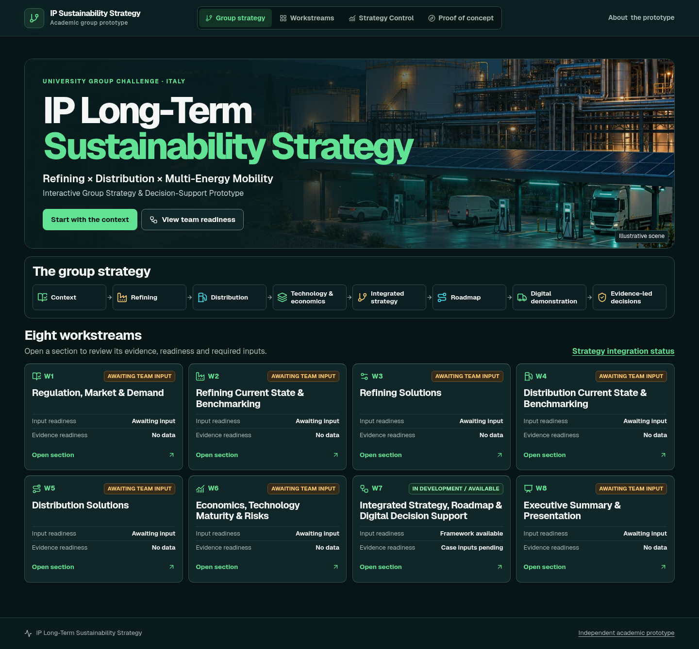](https://queenkm.github.io/ip-transition-strategy/)

| Strategy and readiness | Team evidence and operating context |
| --- | --- |
| [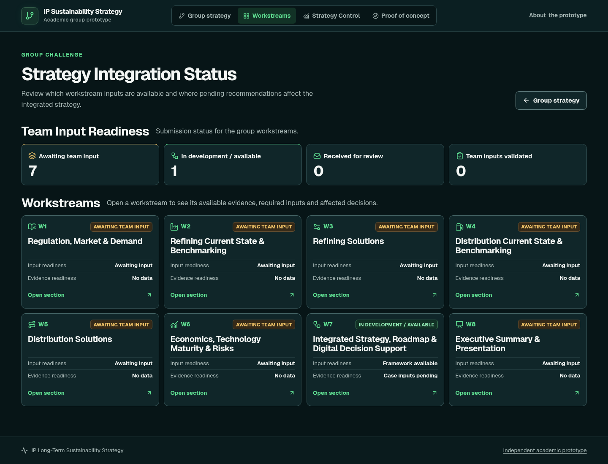](docs/screenshots/workstream-readiness.png) **Workstream readiness** | [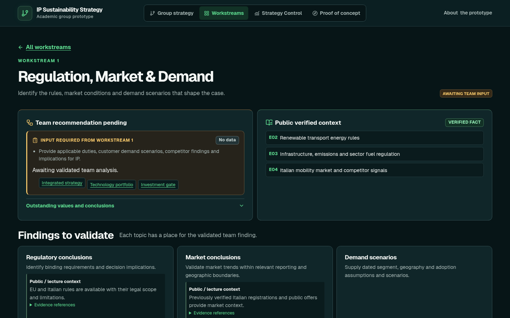](docs/screenshots/context.png) **Regulation, market and demand** |
| [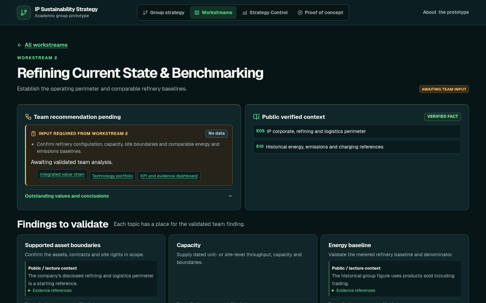](docs/screenshots/refining.png) **Refining** | [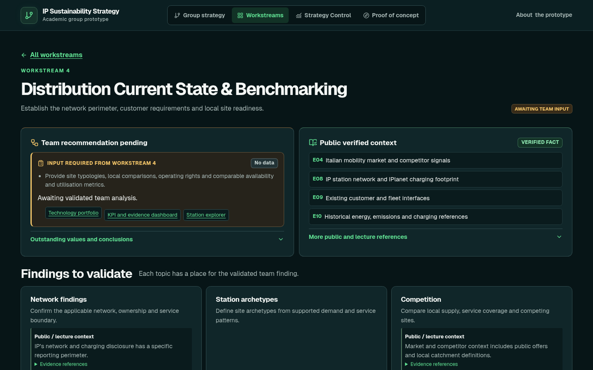](docs/screenshots/distribution.png) **Distribution** |
| [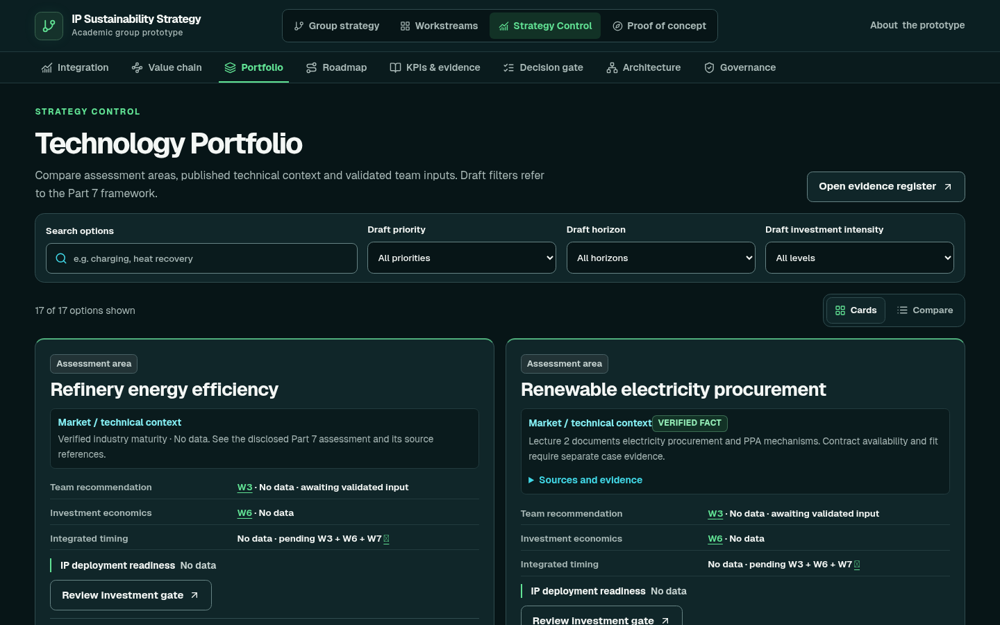](docs/screenshots/technology-portfolio.png) **Technology portfolio** | [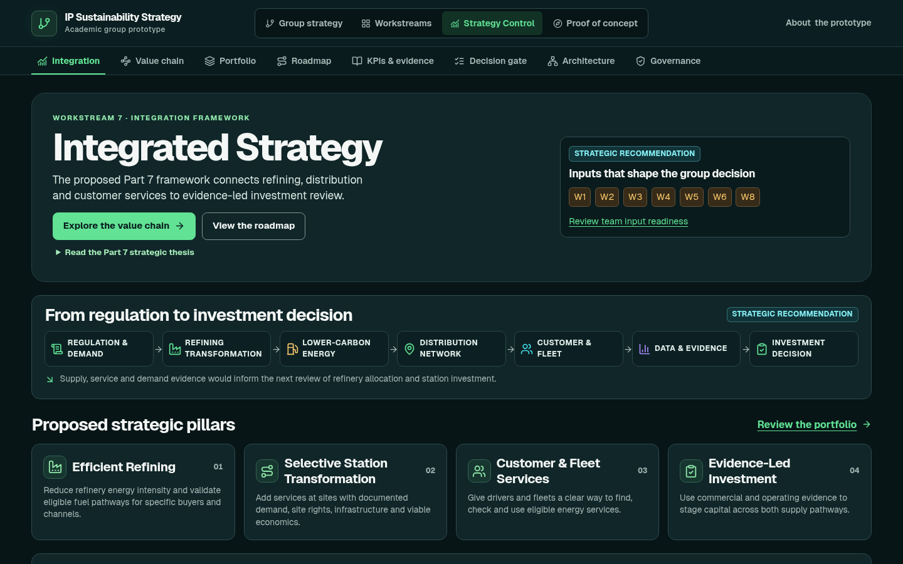](docs/screenshots/integrated-strategy.png) **Part 7 integration framework** |
| [](docs/screenshots/roadmap.png) **Integrated roadmap** | [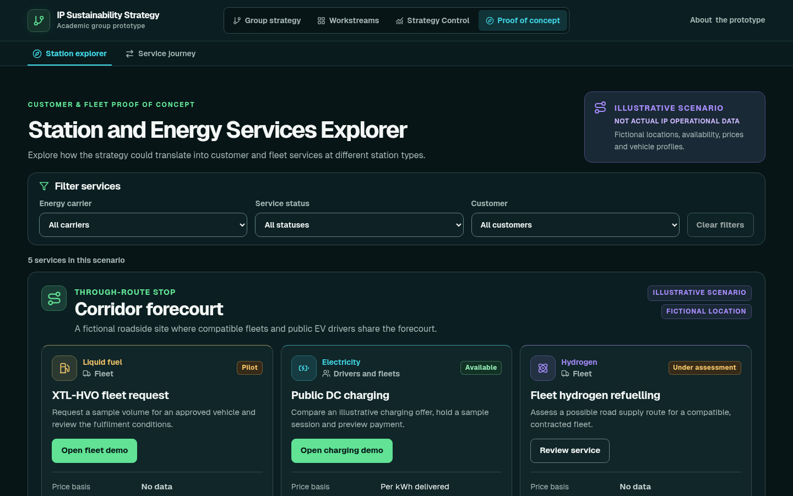](docs/screenshots/station-explorer.png) **Station explorer** |
| [](docs/screenshots/fleet-journey.png) **Fleet journey** | [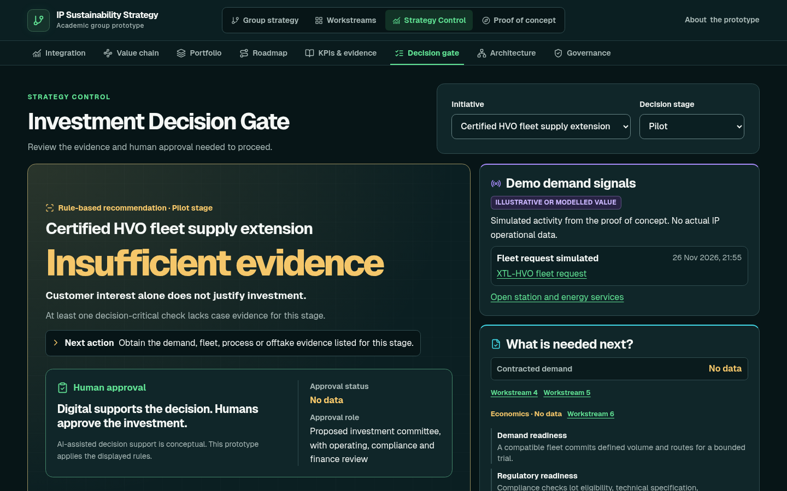](docs/screenshots/decision-gate.png) **Decision gate** |
| [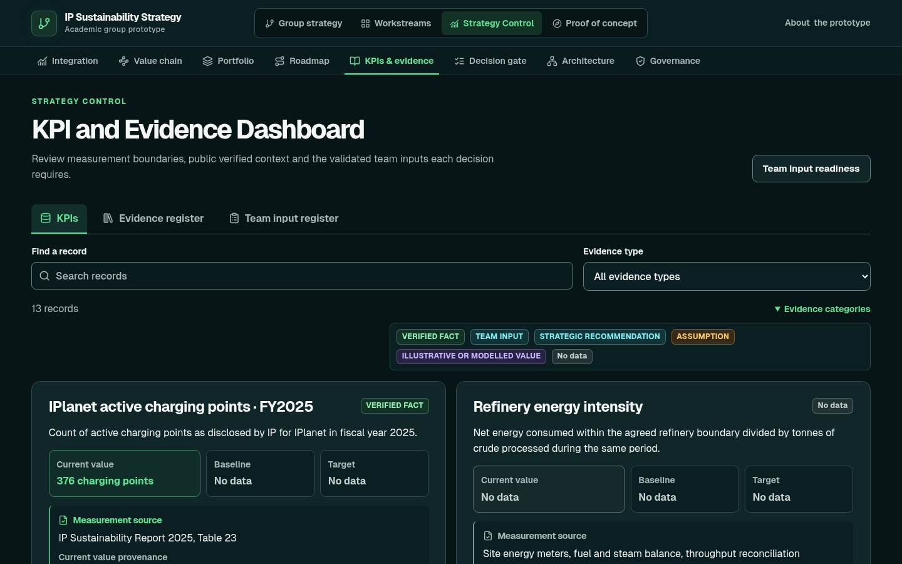](docs/screenshots/evidence.png) **KPI and evidence dashboard** | [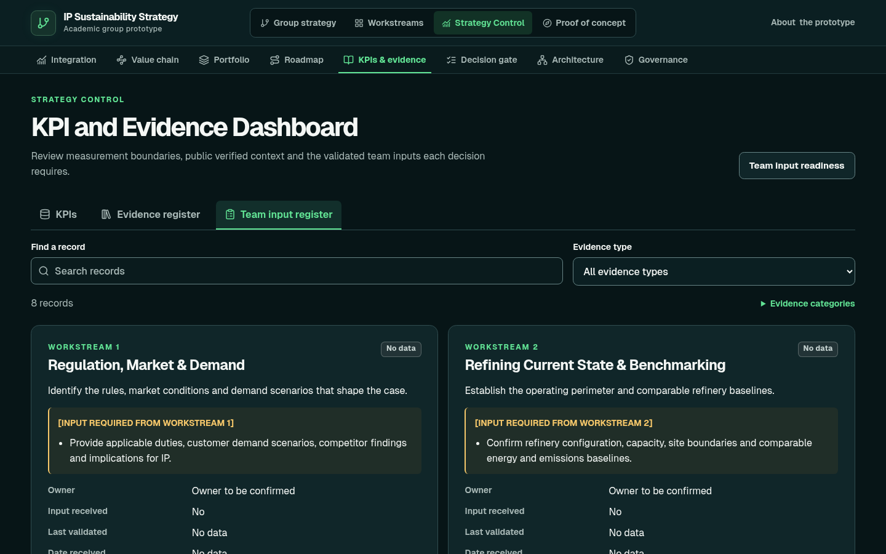](docs/screenshots/team-inputs.png) **Team input register** |
| [](docs/screenshots/architecture.png) **Architecture** | [](docs/screenshots/value-chain.png) **Integrated value chain** |

## Architecture

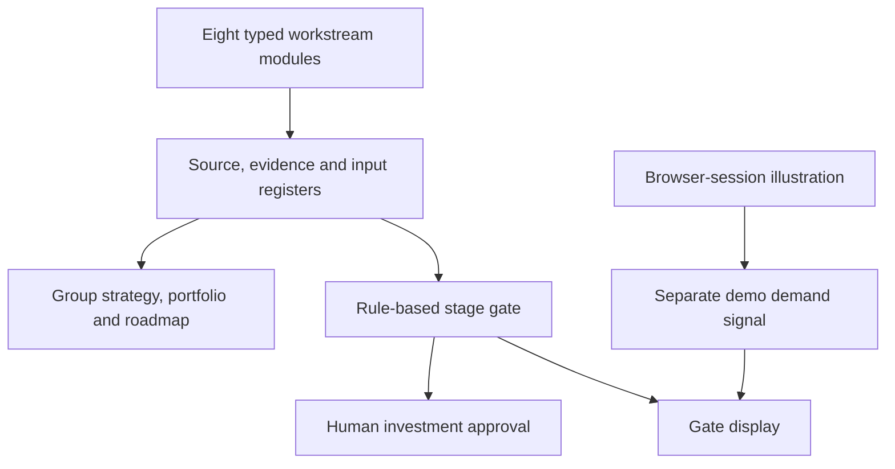

The React prototype uses static TypeScript records and browser-session demo events. The system landscape describes documented, required and future connections. Conceptual AI assistance covers evidence synthesis, scenario and portfolio comparison, and gap detection. The running gate uses transparent rules. [System landscape](https://queenkm.github.io/ip-transition-strategy/#/strategy/architecture) · [Governance](https://queenkm.github.io/ip-transition-strategy/#/strategy/governance)

## Technology stack


CSS Modules and Lucide support the interface. Hash-based routes and relative build assets support project-level GitHub Pages URLs.

## Run locally

Use Node.js 22.12 or later.

```sh
npm install
npm run dev
npm run validate
npm run lint
npm run build
```

Pushes to `main` run the existing deployment workflow. Manage the deployment source in **Settings → Pages → Build and deployment → Source → GitHub Actions**. Integrate submissions in `src/data/workstreams/` and update the shared records they support. [Team input guide](docs/TEAM_INPUT_GUIDE.md)

## Academic disclaimer

This is an independent university proof of concept. Italiana Petroli and its partners have not endorsed it. Demo locations, service availability, payments and requests are fictional and represent no actual IP operational data. Public evidence remains within the scope cited in the evidence register. The bundled Geist font retains its own licence. [Font licence](src/assets/geist-license.txt)
