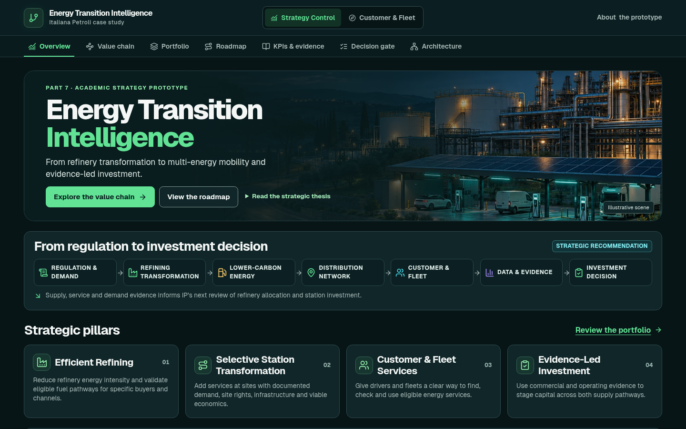
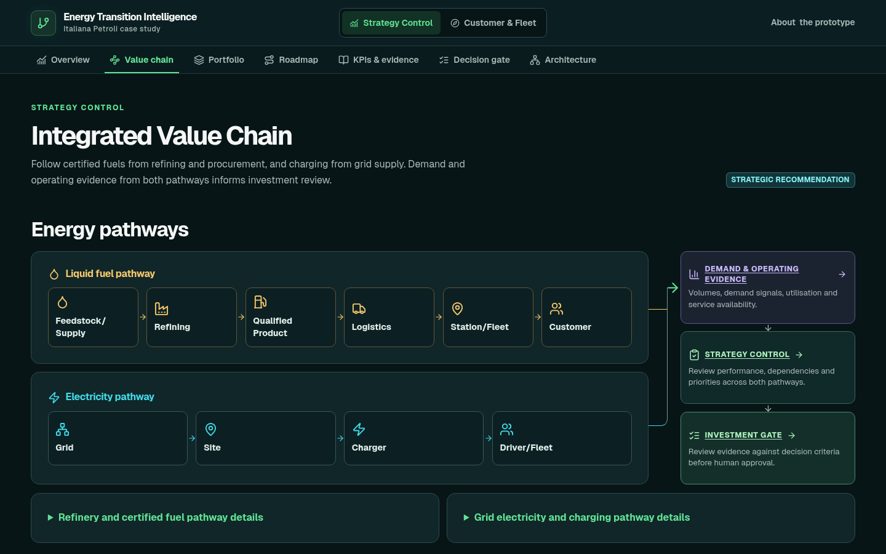
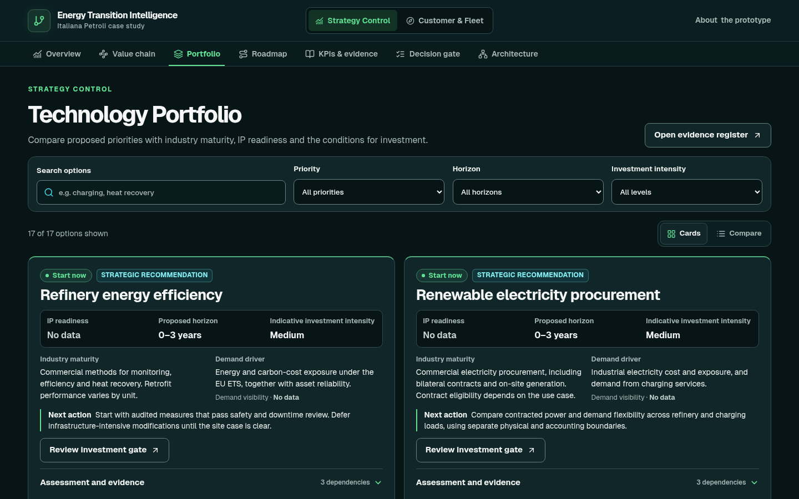
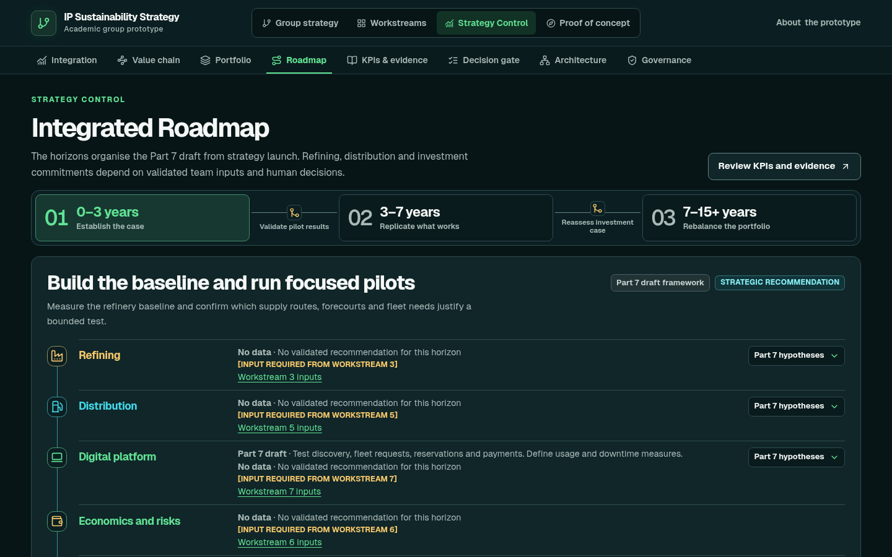
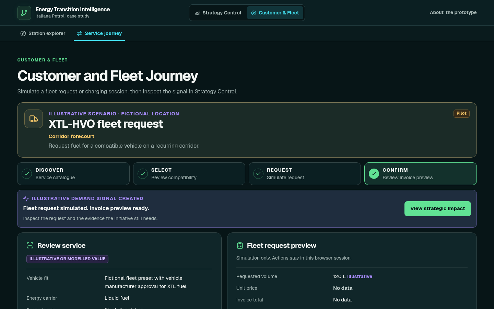
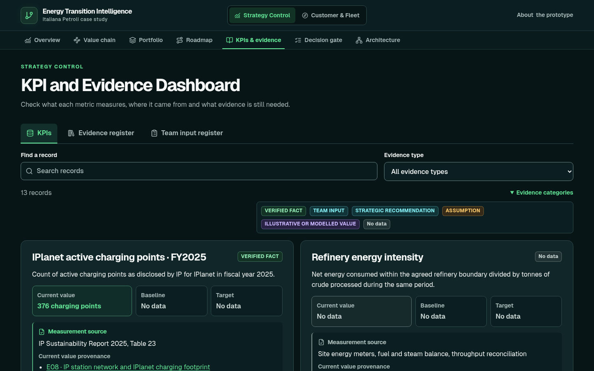
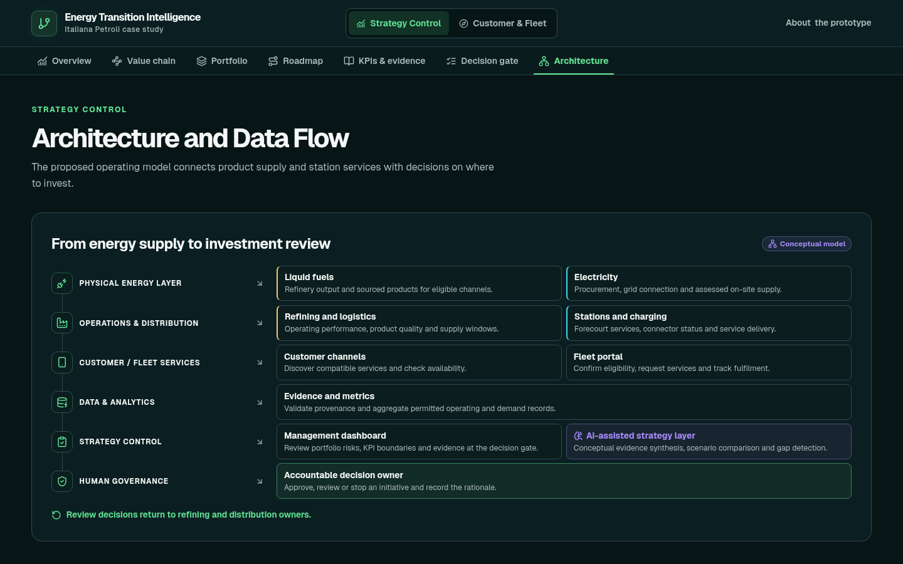
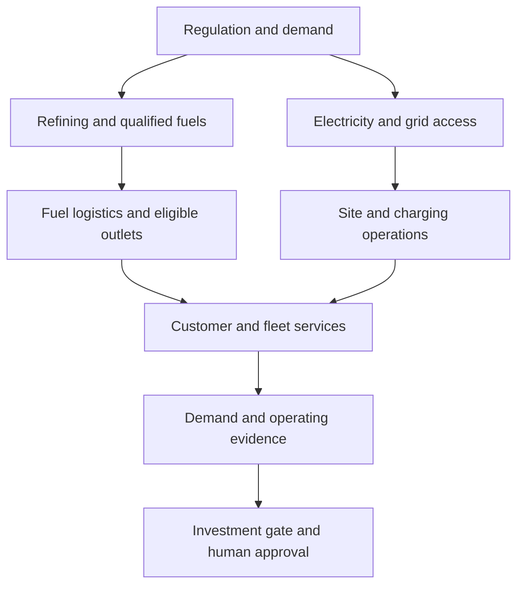
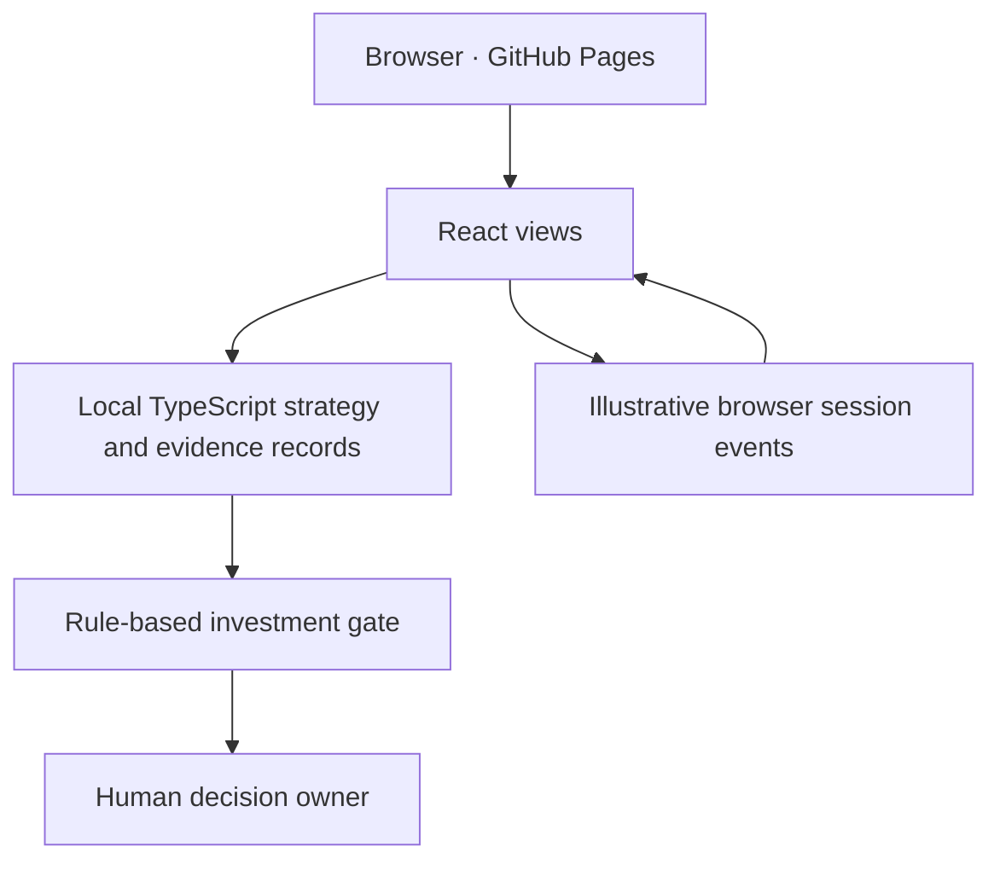

# Energy Transition Intelligence

**Integrated Refining & Multi-Energy Mobility Strategy**

[](https://queenkm.github.io/ip-transition-strategy/)


[](.github/workflows/deploy.yml)
[](https://github.com/QueenKM/ip-transition-strategy/actions/workflows/deploy.yml)

An independent university case study for Italiana Petroli. It makes the case for more efficient refining, selective station upgrades and capital decisions grounded in customer and operating evidence.

**[→ Explore the Live Strategy Prototype](https://queenkm.github.io/ip-transition-strategy/#/strategy)**

[](https://queenkm.github.io/ip-transition-strategy/#/strategy)

### Recommended demo path

1. Read the thesis and four pillars on the [Executive Strategy Dashboard](https://queenkm.github.io/ip-transition-strategy/#/strategy).
2. Trace the sequence of pilots and investment conditions in the [Integrated Roadmap](https://queenkm.github.io/ip-transition-strategy/#/strategy/roadmap).
3. Find **XTL-HVO fleet request** at the fictional corridor forecourt in [Station Explorer](https://queenkm.github.io/ip-transition-strategy/#/mobility/explore).
4. Choose **Open fleet demo**, then **Simulate fleet request** and **View strategic impact** in the [Fleet Journey](https://queenkm.github.io/ip-transition-strategy/#/mobility/journey?service=corridor-demo-hvo).
5. Find the demo demand signal and open the missing checks in the [Investment Decision Gate](https://queenkm.github.io/ip-transition-strategy/#/strategy/gate?initiative=road-hvo-pilot&stage=pilot).

For the electricity pathway, see the [Integrated Value Chain](https://queenkm.github.io/ip-transition-strategy/#/strategy/value-chain) and try the [simulated EV reservation and payment](https://queenkm.github.io/ip-transition-strategy/#/mobility/journey?service=corridor-demo-ev).

## The challenge

How could IP respond to regulation and changing transport demand while investing across refineries, stations and customer services? The university brief asks for a strategy that connects the two businesses and justifies technology, timing and investment choices. [Challenge brief and assessment criteria](https://queenkm.github.io/ip-transition-strategy/#/strategy/evidence?tab=evidence&focus=E01)

**Recommendation.** IP should improve refinery efficiency and qualify fuel supply for specific markets, add charging and other services where local infrastructure and demand support them, and use commercial and operating evidence from both pathways to guide the next investment.

## Live Product

**Strategy Control** covers the case, portfolio, roadmap, KPIs and investment review. **Customer & Fleet** lets a visitor explore eligible offers and simulate a service request. Both views link back to the same initiative and evidence records.

[](https://queenkm.github.io/ip-transition-strategy/#/strategy)

### Four connected contributions

| Contribution | How the prototype demonstrates it |
| --- | --- |
| **Efficient refining and qualified product supply** | Connects site efficiency, feedstock qualification and product traceability to demand from compatible fleets and other fuel buyers. |
| **Selective station transformation** | Compares forecourt and depot options using site rights, power connections, utilisation and service economics. |
| **Customer and fleet services** | Demonstrates service discovery, XTL-HVO compatibility, a fleet request and an EV reservation and payment concept. |
| **Evidence-led investment** | Links operational and commercial evidence to portfolio priorities and decisions across the 0–3, 3–7 and 7–15+ year horizons. |

## Integrated value chain

Certified fuel supply and grid-supplied charging follow different physical routes. Station and fleet services return demand and operating evidence to the same investment gate.

[](https://queenkm.github.io/ip-transition-strategy/#/strategy/value-chain)

## Investment Decision Gate

For the XTL-HVO pilot, the simulated request appears under **Demo demand signals**. The case recommendation remains **Insufficient evidence** while required inputs such as demand commitments, certified supply and economics are missing. The gate shows which checks drive the recommendation, who owns the follow-up and which human role can approve investment.

[](https://queenkm.github.io/ip-transition-strategy/#/strategy/gate?initiative=road-hvo-pilot&stage=pilot)

**Customer signal ≠ Investment decision.** Progression depends on applicable fuel rules, committed fleet volumes, eligible batches, confirmed vehicle and site compatibility, viable delivered economics and human approval. Scale also requires measured pilot performance.

## Product gallery

<table>
  <tr>
    <td width="50%">
      <a href="https://queenkm.github.io/ip-transition-strategy/#/strategy/portfolio"></a>
      <strong>Technology Portfolio</strong><br>
      Technology maturity, priorities and open dependencies.
    </td>
    <td width="50%">
      <a href="https://queenkm.github.io/ip-transition-strategy/#/strategy/roadmap"></a>
      <strong>Integrated Roadmap</strong><br>
      Aligned horizons, investment conditions and review points.
    </td>
  </tr>
  <tr>
    <td width="50%">
      <a href="https://queenkm.github.io/ip-transition-strategy/#/mobility/explore"></a>
      <strong>Station Explorer</strong><br>
      Fictional locations with carrier, audience and status filters.
    </td>
    <td width="50%">
      <a href="https://queenkm.github.io/ip-transition-strategy/#/mobility/journey?service=corridor-demo-hvo"></a>
      <strong>Fleet Journey</strong><br>
      Vehicle fit, simulated request and a linked demand signal.
    </td>
  </tr>
  <tr>
    <td width="50%">
      <a href="https://queenkm.github.io/ip-transition-strategy/#/strategy/evidence"></a>
      <strong>KPIs &amp; Evidence</strong><br>
      Measurement scope, source records and the team input register.
    </td>
    <td width="50%">
      <a href="https://queenkm.github.io/ip-transition-strategy/#/strategy/architecture"></a>
      <strong>Architecture</strong><br>
      Documented capabilities and proposed data connections.
    </td>
  </tr>
</table>

## How the platform works



## Evidence and accountability


| Evidence class | Meaning |
| --- | --- |
| **Verified fact** | A cited claim within the source’s measurement or reporting boundary. |
| **Team input** | A contribution attributed to a workstream. |
| **Strategic recommendation** | A proposed action, priority or decision rule. |
| **Assumption** | A premise requiring confirmation. |
| **Illustrative or modelled value** | A fictional scenario or model output used for demonstration. |
| **No data** | A reliable value for the stated scope is unavailable. |

The evidence register records source, scope, period and outstanding inputs. For example, IP’s report lists 376 active IPlanet charging points for FY2025. This historical network count is separate from candidate-site utilisation and live availability. [IP Sustainability Report 2025, Table 23](https://www.italianapetroli.it/wp-content/uploads/2026/05/Bilancio-di-Sostenibilita-2025.pdf) · [Evidence register](https://queenkm.github.io/ip-transition-strategy/#/strategy/evidence?tab=evidence)

An **AI-assisted strategy layer** is a future concept for summarising cited evidence and highlighting gaps. The app currently applies inspectable TypeScript rules. Approval belongs to the designated human decision owner.

## Architecture

The case architecture proposes permissioned data flows from operating systems to customer and fleet channels and onward to management. The static app demonstrates these flows with local records and session-only demo events.



```text
Physical energy          Liquid fuel supply     Grid electricity
                               │                       │
Operations               Refinery and logistics  Station and charging systems
                                      │          │
Customer and fleet             Customer channels and fleet portal
                                              │
Data and analytics             Aggregate demand, KPIs and provenance
                                              │
Strategy control              Portfolio, roadmap and investment gate
                                              │
Human governance              Decision, rationale and next actions
                                              └──→ Refining and distribution owners
```

The [architecture register](https://queenkm.github.io/ip-transition-strategy/#/strategy/architecture) labels each connection **Existing**, **Required** or **Future** and links the evidence or proposed design.

## Build and maintain


CSS Modules style the interface. GitHub Actions validates and publishes the static app to GitHub Pages.

```text
src/
  app/          Route definitions and application shell entry
  components/   Shared view components and evidence controls
  data/         Strategy, services, KPIs, sources and team inputs
  hooks/        Browser-session demo activity
  models/       TypeScript data contracts
  pages/        Strategy Control and Customer & Fleet screens
  styles/       Shared typography, theme and styling
  utils/        Evidence validation and gate rules
docs/           Screenshots and showcase assets
```

Use Node.js 22.12 or later. Open the address printed by Vite.

```sh
npm install
npm run dev
```

Validate the records and production bundle before deploying.

```sh
npm run lint
npm run validate:data
npm run build
npm run preview
```

For content updates, keep record IDs stable. Add a source and evidence ID with each new claim, update the relevant input request in `src/data/team.ts`, and keep unavailable values as `null`. Enter stage-specific findings and approvals in `recordedEvidence` in [src/data/gates.ts](src/data/gates.ts). **Reset demo** clears session activity.

### Deploy to GitHub Pages

1. Push the project to the repository’s `main` branch. For a different deployment branch, update [the workflow](.github/workflows/deploy.yml).
2. Set **Settings → Pages → Build and deployment → Source** to **GitHub Actions**.
3. Under **Actions**, run **Deploy prototype to GitHub Pages** if needed. Subsequent pushes to `main` deploy automatically.
4. Open `https://USERNAME.github.io/REPOSITORY_NAME/`, replacing `USERNAME` with the account or organisation and `REPOSITORY_NAME` with the repository name. Refresh a route such as `/REPOSITORY_NAME/#/strategy/gate?initiative=road-hvo-pilot` to verify the deployment.

Vite uses a relative asset base. React Router’s hash paths keep refreshes and direct links on the same static entry page.

## Academic context and asset notes

This independent proof of concept supports **Part 7 — Integrated Refining and Distribution Strategy, Digital Platform and Implementation Roadmap** of a university group challenge. It has no affiliation with or endorsement from Italiana Petroli or its partners. Locations, requests, reservations and payments in the demo are fictional. The screenshots show the running prototype.

Public source links and lecture references are maintained in [the source register](src/data/sources.ts). The [social preview image](docs/social-preview.png) and header banner are showcase artwork. No repository licence has been declared. The bundled Geist font retains [its own licence](src/assets/geist-license.txt).
